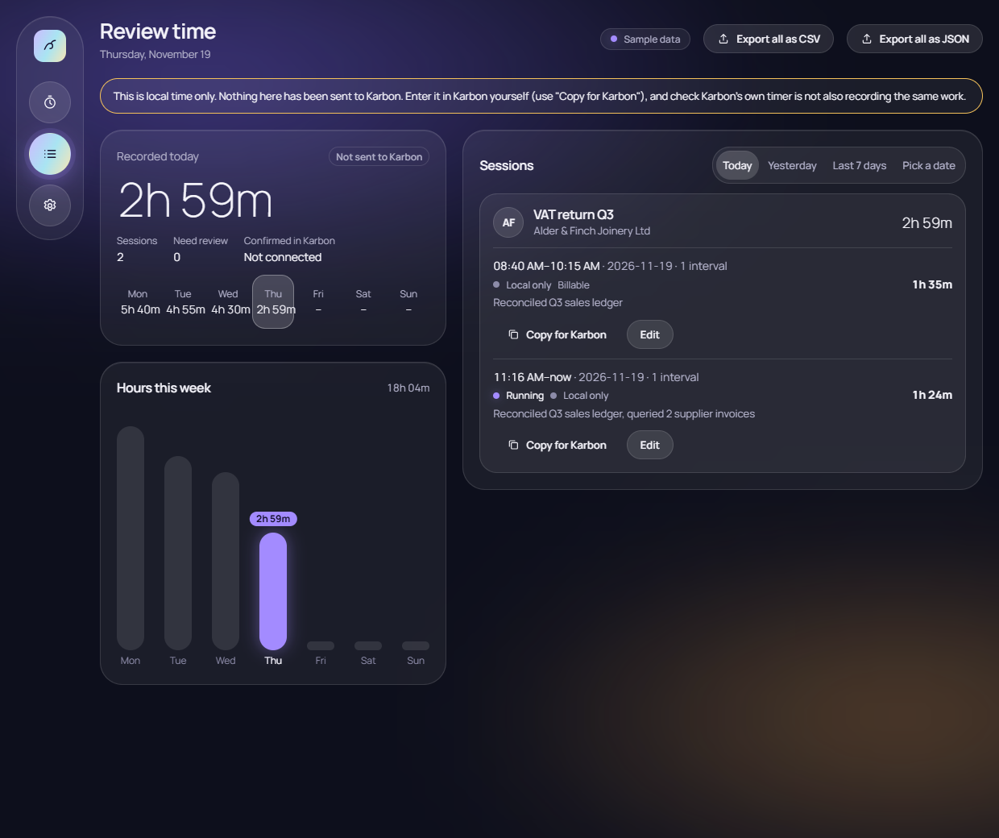
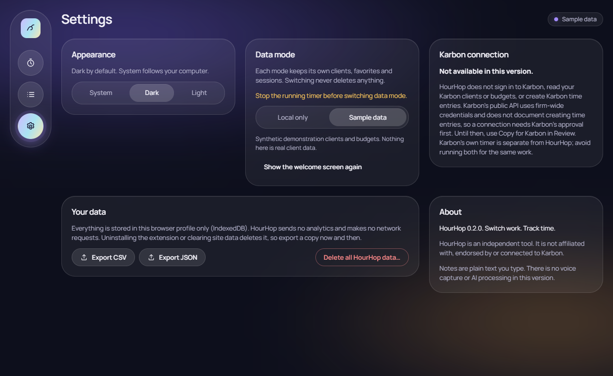

# HourHop

<p align="center"></p>

Switch work. Track time. A Chrome extension that keeps one timer running across your client work, so you can hop between clients and work items in one click and review every interval at the end of the day.

HourHop is an independent tool. It is not affiliated with, endorsed by or connected to Karbon or any other practice-management product. It does not read or write Karbon data; you enter the time you capture into Karbon yourself.

## Install

1. Download `hourhop-<version>-chrome.zip` from the [Releases](../../releases) page and unzip it somewhere you'll keep it (Chrome loads the extension from that folder, so don't delete it).
2. Open `chrome://extensions` and switch on **Developer mode** (top right).
3. Click **Load unpacked** and choose the unzipped folder.
4. Pin HourHop from the puzzle-piece menu, click its icon, then **Open work switcher**.
5. Choose **Track locally** to add your own clients, or **Try sample data** to explore with made-up ones.

Requires Chrome 123 or newer. If your organization manages Chrome, Developer mode may be disabled; ask your IT team. To update, download the new zip, replace the folder contents and click the reload icon on the HourHop card in `chrome://extensions`. Your data is kept across updates.

## Using it with Karbon

1. Add each client and work item once with **Add work** (Track locally mode).
2. Press play on what you're working on. Pressing play on another item switches the timer in one step; pause, resume and stop are on the timer card.
3. Add a plain-text note to the running session if you like.
4. At the end of the day, click **Review time**, check the sessions, correct anything with **Edit** (a reason is required and kept in the edit history), then use **Copy for Karbon** and paste into Karbon's time entry form.

Karbon's own timer is separate, so don't run both for the same work. **Export all as CSV/JSON** in Review or Settings gives you a backup.

## What it does

- One timer for the whole browser profile. Starting other work stops the current session and starts a new one in a single storage transaction, so time is never counted twice.
- Pause, resume and stop. Every session and interval is kept separately for each work item.
- Search, Recent, Favorites and All, with a status filter. Starting completed work asks first.
- Plain-text notes, role, task type and billable flag per session.
- Review by day or week; audited edit, split, discard and "keep as recorded" for flagged sessions (over 8 hours, or the clock moved backwards); per-date totals for sessions that cross midnight.
- CSV and JSON export, protected against spreadsheet formula injection.
- A dark-first "control room" look: frosted glass, a budget dial for the running timer, play and pause on every work item, and a this-week chart. Light and system themes are in Settings. Keyboard: `/` focuses search, arrow keys move through results, Enter starts or pauses.

## Screenshots

All screenshots are from the real extension with made-up sample data.

<table>
  <tr>
    <td align="center" width="33%"><br><sub>Side panel</sub></td>
    <td align="center" width="33%"><br><sub>Light theme</sub></td>
    <td align="center" width="33%"><br><sub>Toolbar popup</sub></td>
  </tr>
</table>

<p align="center"><br><sub>Review time</sub></p>
<p align="center"><br><sub>Settings</sub></p>

## Privacy

Everything stays in your browser profile (IndexedDB). HourHop makes no network requests, has no analytics and asks for one permission, `sidePanel`. Uninstalling the extension or clearing site data deletes your data, so export first.

## Build from source

Requires Node 22+ and pnpm 10.

```sh
pnpm install
pnpm build        # unpacked extension in .output/chrome-mv3
pnpm zip          # installable zip in .output/
```

| Command | What it does |
|---|---|
| `pnpm dev` | WXT dev mode with reload |
| `pnpm typecheck` | TypeScript strict check |
| `pnpm test` | Vitest: domain logic, IndexedDB ledger (fake-indexeddb), UI architecture guards |
| `pnpm e2e` | Playwright against the built extension in a fresh temporary profile (run `pnpm build` first) |
| `pnpm check` | All of the above in order |
| `node scripts/make-icons.mjs` | Re-render toolbar icons from `public/icon/icon.svg` |
| `node scripts/readme-assets.mjs` | Regenerate the README banner GIF and screenshots in `docs/images/` from the built extension (needs ffmpeg; run `pnpm build` first) |

E2E tests use Playwright's bundled Chromium by default, a throwaway profile per test and synthetic data only. Install it once with `pnpm exec playwright install chromium`. Set `BRANDED=1` to run them on your installed Google Chrome instead; branded Chrome ignores `--load-extension`, so the fixture loads the build through the DevTools `Extensions.loadUnpacked` command. Set `HEADED=1` to watch. Screenshots, accessibility results and timings go to `.tmp/evidence/` (override with `EVIDENCE_DIR`).

## How it works

- `src/domain/`: pure TypeScript for timer transitions, durations and local-date attribution, budgets, audited edits and export.
- `src/storage/ledger.ts`: the IndexedDB ledger. Every timer command is one readwrite transaction over the global active pointer, the session records and an operation journal, so commands from the popup and side panel serialize in IndexedDB itself. Success is shown only after the transaction commits.
- `src/ui/`: Preact. `tokens.css` holds every colour, size and timing value; `components.tsx` is the only module that renders raw controls; `parts.tsx` and `views/` compose them. `tests/ui-guards.test.ts` enforces both rules.
- No background service worker, content script or host permission. Elapsed time is derived from stored timestamps, so closing every window or restarting the browser loses nothing.

Design rules are in [docs/design.md](docs/design.md).

## Limits

- No Karbon sign-in, client sync or automatic time submission. Karbon's public API documents no per-user sign-in and no way to create time entries, so this would need Karbon's approval.
- Data lives in one browser profile; there is no sync between devices.
- Layout is designed for 320 to 600 CSS px wide. At 200% zoom in a narrow side panel it overflows sideways.

## Contributing

Bug reports and ideas are welcome as [issues](../../issues). Pull requests are not being accepted at the moment.

## Credits

The Manrope typeface is bundled under the SIL Open Font License 1.1; its licence ships with the extension in `licenses/Manrope-OFL.txt`.

## License

[Functional Source License 1.1, MIT Future License](LICENSE.md) (FSL-1.1-MIT). You may use, copy and modify HourHop for any purpose except offering a competing commercial product or service. Each release becomes available under the MIT license two years after it is published.

Copyright 2026 Vikash Chand.
