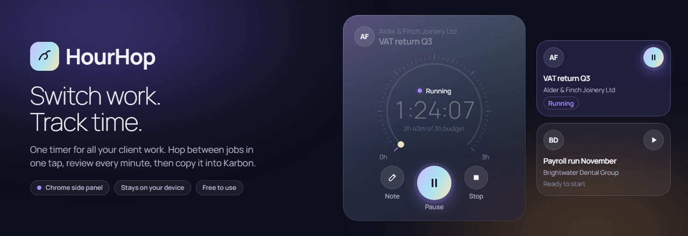
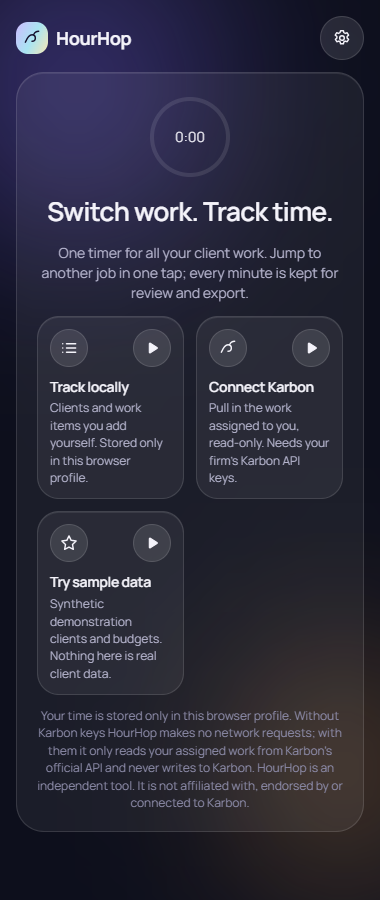
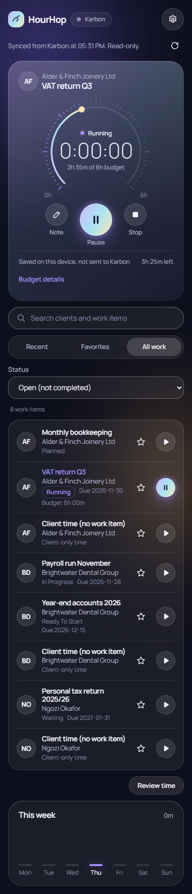
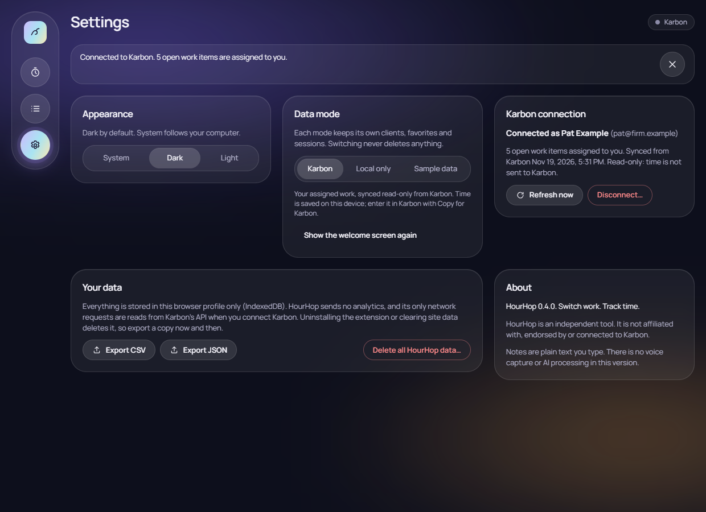
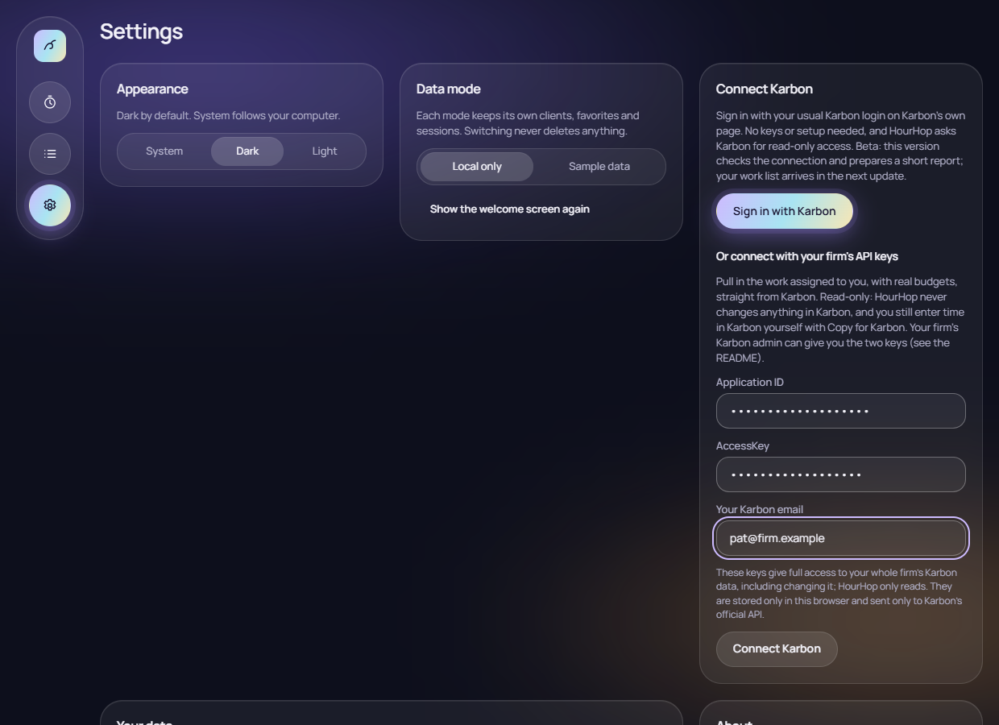
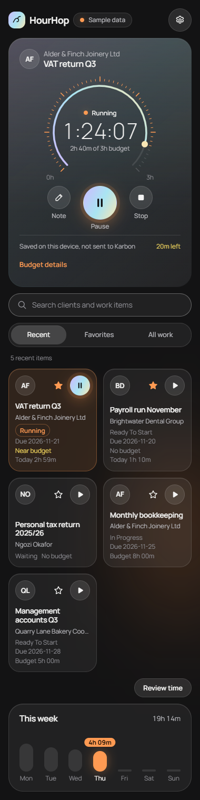
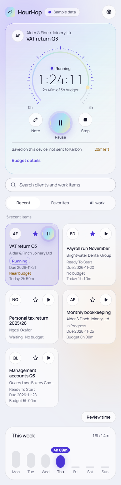
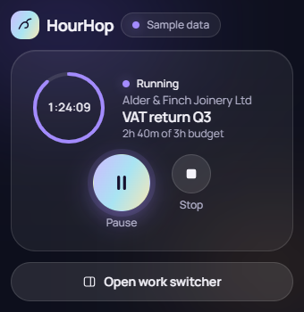

# HourHop

<p align="center"></p>

Switch work. Track time. A Chrome extension that keeps one timer running across your client work, so you can hop between clients and work items in one click and review every interval at the end of the day.

With your firm's Karbon keys, HourHop pulls in the work assigned to you, with each job's real budget, straight from Karbon's official API. Press play on a job to time it, hop to the next one in a tap, and review the day when you're done. Without keys it works on its own with clients you add yourself.

HourHop is an independent tool. It is not affiliated with or endorsed by Karbon. It only ever reads from Karbon: Karbon's API has no way for other apps to create time entries, so you still enter the time in Karbon, helped by **Copy for Karbon**.

## Install

1. Download `hourhop-<version>-chrome.zip` from the [Releases](../../releases) page and unzip it somewhere you'll keep it (Chrome loads the extension from that folder, so don't delete it).
2. Open `chrome://extensions` and switch on **Developer mode** (top right).
3. Click **Load unpacked** and choose the unzipped folder.
4. Pin HourHop from the puzzle-piece menu, click its icon, then **Open work switcher**.
5. Choose **Connect Karbon** (below), **Track locally** to add your own clients, or **Try sample data** to explore with made-up ones.

Requires Chrome 123 or newer. If your organization manages Chrome, Developer mode may be disabled; ask your IT team. To update, download the new zip, replace the folder contents and click the reload icon on the HourHop card in `chrome://extensions`. Your data is kept across updates.

## Connect Karbon

### Sign in with Karbon (beta)

Open HourHop **Settings** and click **Sign in with Karbon**. Karbon's own login page opens in a small window; sign in as you normally do, and the window closes by itself. There are no keys, no email to type and nothing for an admin to set up. HourHop asks Karbon for read-only access only, through Karbon's official MCP server (the same sign-in Claude uses to connect to Karbon).

This beta checks the connection and prepares a **connection report**: the list of tools Karbon's MCP server offers, with none of your firm's data. Karbon does not publish that list, so the first person to sign in should click **Copy connection report** and send it to whoever maintains HourHop. The next update uses it to load your work items and clients automatically.

### Connect with your firm's API keys

The other way in is Karbon's REST API, which uses two firm-wide keys instead of a personal sign-in. It already loads your assigned work and budgets today. Your firm's Karbon admin sets this up once:

1. Register a developer account at [developers.karbonhq.com/register](https://developers.karbonhq.com/register) and ask Karbon to enable API v3 for the firm (Karbon turns it on by request). Karbon sends the **Application ID** by secure message when the application is registered.
2. In Karbon, go to **Settings**, then **Connected Apps**, then **API Applications**, and open the application. Both keys are listed there: the Application ID (sent as the bearer token) and the **AccessKey**.
3. Share the Application ID and AccessKey with the colleagues who will use HourHop, the way your firm shares other credentials.

Each colleague then opens HourHop **Settings**, enters the Application ID, the AccessKey and the email they sign in to Karbon with, and clicks **Connect Karbon**. HourHop checks the keys, finds their Karbon user and switches to Karbon mode. If the email is not found, type it exactly as it appears on their Karbon user profile.

What happens next:

- The work items assigned to you that aren't completed (Planned, Ready To Start, In Progress and Waiting) appear in the side panel, grouped by client, with Karbon's statuses and due dates. Completed work is never downloaded. They refresh automatically every 15 minutes while HourHop is open, or straight away with **Refresh**.
- Budgets come from each work item's Karbon estimates: the work item total and your own allocation, with time already recorded in Karbon. Hourly rates are never shown. Time you have tracked in HourHop but not yet entered in Karbon shows separately; it is never added to Karbon's figures.
- After you paste a session into Karbon, press **Mark entered** in Review so it no longer counts as unentered time.

Please know before connecting:

- **The keys give full access to the whole firm's Karbon data.** Karbon's API uses the same two keys to read and to create, change or delete contacts, work items, notes and more, and Karbon documents no read-only key. HourHop only reads your assigned work and its budgets, but the keys themselves are not limited to you or to reading. Treat them like an admin password. They are stored only in this browser profile, are sent only to `https://api.karbonhq.com`, are never shown again after saving, and are removed by **Disconnect** or **Delete all data**.
- **HourHop never writes to Karbon.** With keys, every request is a read (`GET`). With Sign in with Karbon, HourHop asks only for read-only access, refuses a sign-in that grants more, and calls no Karbon tool that could change anything. Tests on the shipped build enforce both.
- **Not yet verified against a live Karbon account.** The integration is built and tested against Karbon's published API specification ([karbonhq/karbon-api-reference](https://github.com/karbonhq/karbon-api-reference), version of 29 October 2026, last checked 19 November 2026) with a simulated Karbon that behaves as that specification describes. If connecting fails, the message says why (rejected keys, API access not enabled, email not found, network); please open an issue with that message.

## Using it day to day

1. Press play on what you're working on. Pressing play on another item switches the timer in one step; pause, resume and stop are on the timer card.
2. Add a plain-text note to the running session if you like.
3. At the end of the day, click **Review time**, check the sessions, correct anything with **Edit** (a reason is required and kept in the edit history), then use **Copy for Karbon**, paste into Karbon's time entry form and press **Mark entered**.

Without Karbon keys, add each client and work item once with **Add work** (Track locally mode) instead. Karbon's own timer is separate, so don't run both for the same work. **Export all as CSV/JSON** in Review or Settings gives you a backup.

## What it does

- One timer for the whole browser profile. Starting other work stops the current session and starts a new one in a single storage transaction, so time is never counted twice.
- Pause, resume and stop. Every session and interval is kept separately for each work item.
- Search, Recent, Favorites and All, with a status filter. Starting completed work asks first.
- Plain-text notes, role, task type and billable flag per session.
- Review by day or week; audited edit, split, discard and "keep as recorded" for flagged sessions (over 8 hours, or the clock moved backwards); per-date totals for sessions that cross midnight.
- CSV and JSON export, protected against spreadsheet formula injection.
- A dark-first "control room" look: frosted glass, a budget dial for the running timer, play and pause on every work item, and a this-week chart. Light and system themes are in Settings. Keyboard: `/` focuses search, arrow keys move through results, Enter starts or pauses.

## Screenshots

All screenshots are from the real extension with made-up data. The Karbon ones use a simulated Karbon, never a real account.

<table>
  <tr>
    <td align="center" width="33%"><br><sub>First run</sub></td>
    <td align="center" width="33%"><br><sub>Karbon mode</sub></td>
    <td align="center" width="33%"><br><sub>Connected to Karbon</sub></td>
  </tr>
</table>

<p align="center"><br><sub>Connect Karbon</sub></p>

<table>
  <tr>
    <td align="center" width="33%"><br><sub>Side panel</sub></td>
    <td align="center" width="33%"><br><sub>Light theme</sub></td>
    <td align="center" width="33%"><br><sub>Toolbar popup</sub></td>
  </tr>
</table>

<p align="center"><br><sub>Review time</sub></p>

## Privacy

Everything stays in your browser profile (IndexedDB). There are no analytics. HourHop asks for the `sidePanel` permission and access to Karbon only: its API (`api.karbonhq.com`), its sign-in server (`identity.karbonhq.com`), its MCP server (`mcp.karbonhq.com`), and the local address `127.0.0.1:53682` that Karbon's sign-in returns to, so HourHop can read the sign-in result. It makes no network request at all until you sign in or enter Karbon keys, and then only reads. Sign in with Karbon keeps no password or token. Uninstalling the extension or clearing site data deletes your data, so export first.

## Build from source

Requires Node 22+ and pnpm 10.

```sh
pnpm install
pnpm build        # unpacked extension in .output/chrome-mv3
pnpm zip          # installable zip in .output/
```

| Command | What it does |
|---|---|
| `pnpm dev` | WXT dev mode with reload |
| `pnpm typecheck` | TypeScript strict check |
| `pnpm test` | Vitest: domain logic, IndexedDB ledger (fake-indexeddb), UI architecture guards |
| `pnpm e2e` | Playwright against the built extension in a fresh temporary profile (run `pnpm build` first) |
| `pnpm check` | All of the above in order |
| `node scripts/make-icons.mjs` | Re-render toolbar icons from `public/icon/icon.svg` |
| `node scripts/readme-assets.mjs` | Regenerate the README banner GIF and screenshots in `docs/images/` from the built extension (needs ffmpeg; run `pnpm build` first) |

E2E tests use Playwright's bundled Chromium by default, a throwaway profile per test and synthetic data only. Install it once with `pnpm exec playwright install chromium`. Set `BRANDED=1` to run them on your installed Google Chrome instead; branded Chrome ignores `--load-extension`, so the fixture loads the build through the DevTools `Extensions.loadUnpacked` command. Set `HEADED=1` to watch. Screenshots, accessibility results and timings go to `.tmp/evidence/` (override with `EVIDENCE_DIR`).

## How it works

- `src/domain/`: pure TypeScript for timer transitions, durations and local-date attribution, budgets, audited edits and export.
- `src/integrations/karbon.ts` and `karbon-sync.ts`: the read-only Karbon client and sync. The client is the only code allowed to make network requests; it sends `GET` requests to `https://api.karbonhq.com` only, follows pagination links only on that origin, retries rate limits a bounded number of times, and never puts the keys in errors or logs. A failed refresh keeps the last good work list.
- `src/storage/ledger.ts`: the IndexedDB ledger. Every timer command is one readwrite transaction over the global active pointer, the session records and an operation journal, so commands from the popup and side panel serialize in IndexedDB itself. Success is shown only after the transaction commits.
- `src/ui/`: Preact. `tokens.css` holds every colour, size and timing value; `components.tsx` is the only module that renders raw controls; `parts.tsx` and `views/` compose them. `tests/ui-guards.test.ts` enforces both rules.
- No background service worker or content script, and no host access beyond Karbon's API. Elapsed time is derived from stored timestamps, so closing every window or restarting the browser loses nothing.

Design rules are in [docs/design.md](docs/design.md).

## Limits

- Time is not saved into Karbon automatically. Karbon's API can read time entries but not create them; see the [roadmap](docs/roadmap.md).
- Connecting needs firm-wide Karbon API keys, because Karbon offers no per-user sign-in for other apps.
- Data lives in one browser profile; there is no sync between devices.
- Layout is designed for 320 to 600 CSS px wide. At 200% zoom in a narrow side panel it overflows sideways.

## Contributing

Bug reports and ideas are welcome as [issues](../../issues). Pull requests are not being accepted at the moment.

## Credits

The Manrope typeface is bundled under the SIL Open Font License 1.1; its licence ships with the extension in `licenses/Manrope-OFL.txt`.

## License

[Functional Source License 1.1, MIT Future License](LICENSE.md) (FSL-1.1-MIT). You may use, copy and modify HourHop for any purpose except offering a competing commercial product or service. Each release becomes available under the MIT license two years after it is published.

Copyright 2026 Vikash Chand.
